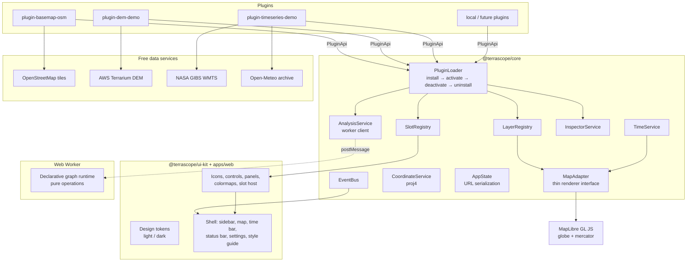
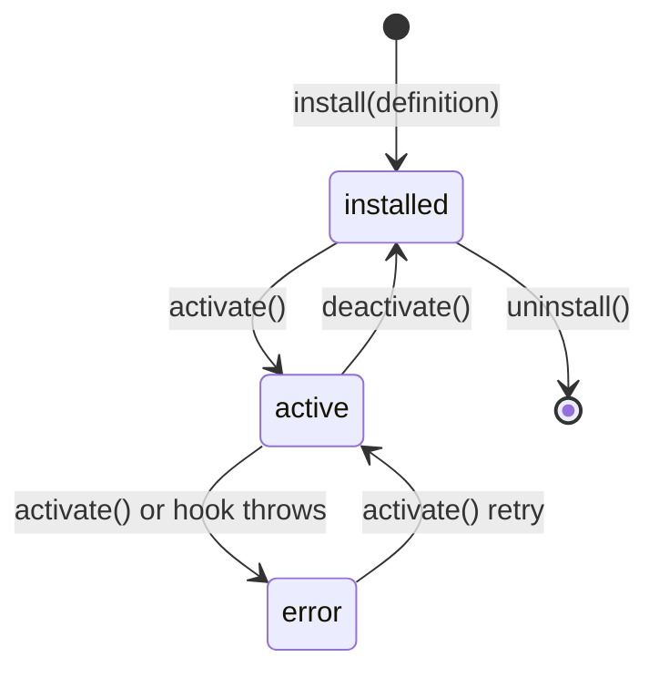

# Architecture

## Guiding principle

The core is a runtime, not a data product. It knows how to draw a layer, but
never which layer to draw. Every concrete thing — base map, DEM, satellite
imagery, weather series, legend, tool — arrives through a plugin. The core
package has no dependency on any plugin, and `pnpm lint:deps` fails the build if
one is added.

## Layers of the system



## Packages

| Package | Responsibility | May depend on |
| --- | --- | --- |
| `@terrascope/plugin-api` | Public types, manifest schema, event map, analysis graph. Types only. | nothing |
| `@terrascope/core` | Runtime services, map adapter, plugin loader, analysis worker. | `plugin-api`, MapLibre, proj4 |
| `@terrascope/ui-kit` | Tokens, themes, icon wrapper, React controls, colormaps, `SlotHost`. | `plugin-api`, React, Lucide |
| `apps/web` | Composition of core + UI + plugins, worker entry, shell layout. | all of the above |
| `plugins/*` | Data sources and their UI, analysis aliases. | `plugin-api` only |

The dependency direction is one-way: plugins know the API, the core knows
nothing about plugins, and `apps/web` is the only place that composes them.

## Plugin lifecycle



- `install` validates the manifest (required fields, reverse-DNS id, SemVer,
  capability set, network declarations) and checks the `coreApi` range against
  the running core API version.
- `activate` resolves declared plugin dependencies first, builds a scoped API
  object and calls the plugin. Every registration made through that API is
  tracked so it can be disposed.
- `deactivate` calls the plugin hook, disposes all registrations (layers, slots,
  inspectors, providers, listeners, settings handlers) and removes the plugin's
  layers and UI.
- `uninstall` deactivates and removes the plugin record; plugin storage keys can
  be cleared by the host.
- Errors never escape: a throwing plugin is marked `error`, its contributions
  are disposed, a toast is shown, and the application keeps running.

## Layer contract

Every layer descriptor carries **name, kind, unit, value range, NoData value,
scale/offset, temporal support, source, license and attribution**. The core
renders an attribution panel from these fields, so no plugin can display data
without attribution. Raster and hillshade layers are rendered by the MapLibre
adapter directly from the descriptor; vector layers are normalized to GeoJSON.

Layer order is explicit (`zIndex`, then registration order). Visibility,
opacity and blend mode live in the registry; the adapter reconciles the map
sources and layers declaratively on every change.

## Time

A single global `TimeState` (instant, range, resolution) is owned by
`TimeService`. Layers declare their temporal support and resolution; the
adapter resolves `{time}` tokens in tile templates with the layer's resolution.
The time bar always reflects the union of all temporal layer ranges. Changing
time re-syncs only the affected tile sources.

## Coordinates

`CoordinateService` wraps proj4 and always exposes WGS84 and Web Mercator, plus
any CRS a plugin registers. It provides transformation, formatting (decimal or
DMS), parsing, Haversine distance and spherical polygon area. Heights are an
optional part of a coordinate; all times are UTC ISO 8601.

## Analysis graphs

Analysis is declarative and serializable:

```ts
const graph = {
  schemaVersion: 1,
  nodes: [
    { id: "table", op: "table.fromSeries", inputs: { times, values }, params: { unit: "°C" } },
    { id: "mean", op: "value.mean", inputs: { values } },
    { id: "chart", op: "chart.fromTable", inputs: { table: { $node: "table" } } },
  ],
  outputs: ["mean", "chart"],
};
const run = await api.analysis.run(graph); // executed in a worker
```

Nodes reference operations by id, inputs are literals or `{ "$node": id }`.
Because no functions cross the boundary, the same graph can run in a browser
worker today and on a server later, and it can be stored and reproduced. Plugins
add operations as aliases of worker-safe primitives (`value.mean`,
`table.fromSeries`, `chart.fromTable`, …); executable plugin operations need the
worker module contract described in [ADR 0006](docs/adr/0006-analysis-graphs.md).

Results have one of three shapes: `table`, `chart` or `value`. They are plain
JSON and renderable by any client.

## State and sharing

`AppState` contains the map view, time, theme, locale, layer visibility and
opacity, **plugin ids and versions**, and plugin settings. It is base64url
encoded into the `state` query parameter and updated with `replaceState` (no
history spam). The share button copies the resulting URL. Loading a URL restores
the state after the plugins have been installed.

## UI and design system

- Design tokens in `packages/ui-kit/src/styles.css`; switching theme only swaps
  token values (`[data-theme]`), never components.
- Both themes meet WCAG AA for text and controls; scientific colormaps are
  identical in both themes.
- Icons come from Lucide behind a single `<Icon>` component, so the set can be
  replaced. Every icon-only button has an `aria-label`, a tooltip and, where
  relevant, a keyboard hint.
- Slots: `sidebar`, `toolbar`, `map-overlay`, `legend`, `detail`, `settings`,
  `context-menu`, `statusbar`. A slot entry mounts plain DOM and returns an
  unmount function.
- `#style-guide` in the app (or the info button) shows every UI-kit component in
  both themes.

## Performance budgets

| Budget | Value | Check |
| --- | --- | --- |
| Initial JS bundle (minified) | ≤ 1.7 MB | `node scripts/check-bundle.mjs` in CI |
| Analysis bundle in a worker | ≤ 100 kB | observed 3.9 kB |
| Tile loading | streamed by MapLibre, no eager prefetch | — |
| Interaction | analysis never on the UI thread; hover updates are rAF-throttled | — |

MapLibre dominates the initial bundle. If the budget is exceeded, the next step
is to lazy-load the map adapter and the plugin bundles; this is recorded as a
follow-up in the GitHub plan.

## Security and trust

Two trust levels are defined (ADR 0005):

- **Level A — trusted**: bundled or locally installed plugins run in the page
  with full API access. The manifest declares capabilities and allowed
  hostnames, which are shown in the plugin manager and validated on install.
- **Level B — untrusted**: designed as an iframe sandbox with a postMessage RPC
  bridge and no direct DOM or network access. Not implemented in the MVP; a
  spike plan is part of ADR 0005.

There is no telemetry, no tracker, no external font and no runtime CDN.

## Known limitations / deviations

1. **Trust level B** (sandboxed third-party plugins) is designed but not built.
2. **Blend modes** are part of the layer model and state, but MapLibre has no
   per-layer blend mode; the adapter currently ignores them (ADR 0010).
3. **Analysis operations** contributed by plugins are serializable aliases of
   core primitives. A worker-module contract for arbitrary plugin operations is
   a follow-up.
4. **Plugin lazy loading**: reference plugins are statically composed in
   `apps/web/src/plugins.ts`. Runtime loading from a `plugin.json` URL works, but
   code splitting per plugin is not implemented yet.
5. **E2E and screenshot tests** are in the repository but were not executed in
   the build environment used to create this commit (no browser installed).
6. **Optional backend** (Fastify proxy/cache/analysis host) and the
   **script editor** are out of the MVP scope by the specification.
7. The project name **TerraScope** is a working title. The specification asks to
   agree on a name before phase 1; the implementation was requested in one pass,
   so the name is recorded as an assumption (ADR 0011).
